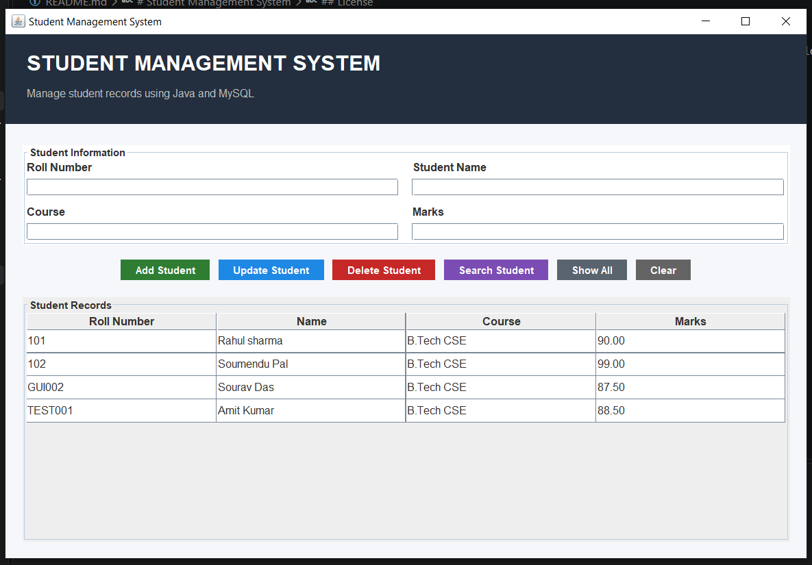

# Student Management System 2.0

A Java desktop application for managing student records, built using Java Swing, MySQL, JDBC and Maven. The application provides administrator authentication, student record management, advanced search, filtering, sorting and CSV export.

## Features

### Student Management
- Add new student records.
- View all student records.
- Search students by roll number.
- Update student information.
- Delete student records.
- Store student email addresses and phone numbers.
- Validate user inputs.

### Administrator Authentication
- Administrator login system.
- Password hashing using PBKDF2-HMAC-SHA256.
- Random salt generation.
- Password verification.
- Change administrator password.
- Logout functionality.
- Initial administrator account setup.

### Advanced Search
Search students using:
- Roll number
- Student name
- Email address
- Phone number
- Course

### Filtering and Sorting
- Filter students by course.
- Filter by minimum marks.
- Filter by maximum marks.
- Sort by roll number, name, course or marks.
- Sort in ascending or descending order.
- Reset filters.

### CSV Export
- Export student records into CSV files.
- Open exported files using Microsoft Excel.
- UTF-8 encoding support.
- Handle quotation marks, commas and empty fields.
- Basic spreadsheet formula-injection protection.

### Automated Testing
- JUnit 5 integration.
- Password utility tests.
- CSV export tests.
- Automated test execution through Maven.

## Technologies Used

| Technology | Purpose |
|---|---|
| Java 17 | Programming language target |
| Java Swing | Graphical user interface |
| MySQL | Database management |
| JDBC | Database connectivity |
| Maven | Build and dependency management |
| JUnit 5 | Automated testing |
| MySQL Connector/J | MySQL JDBC driver |
| Git and GitHub | Version control |
| Visual Studio Code | Development environment |

## Project Structure

```text
StudentManagementSystem/
│
├── src/
│   └── com/studentmanagement/
│       ├── model/
│       │   ├── Student.java
│       │   └── Admin.java
│       │
│       ├── dao/
│       │   ├── StudentDAO.java
│       │   └── AdminDAO.java
│       │
│       ├── database/
│       │   └── DatabaseConnection.java
│       │
│       ├── ui/
│       │   ├── Main.java
│       │   ├── AdminLogin.java
│       │   ├── AdminSetup.java
│       │   └── StudentManagementGUI.java
│       │
│       └── util/
│           ├── PasswordUtil.java
│           └── CsvExporter.java
│
├── test/
│   └── com/studentmanagement/util/
│       ├── PasswordUtilTest.java
│       └── CsvExporterTest.java
│
├── screenshots/
├── .vscode/
├── lib/
├── target/
├── db.properties.example
├── .gitignore
├── pom.xml
└── README.md
```

## Requirements

- JDK 17 or newer.
- Apache Maven 3.9 or newer.
- MySQL Server.
- MySQL Workbench (optional).

## Database Setup

First, create the database:

```sql
CREATE DATABASE student_management;
USE student_management;
```

### Create the students table

```sql
CREATE TABLE students (
    roll_number VARCHAR(20) PRIMARY KEY,
    name VARCHAR(100) NOT NULL,
    email VARCHAR(120),
    phone VARCHAR(20),
    course VARCHAR(100) NOT NULL,
    marks DECIMAL(5,2) NOT NULL,
    CHECK (marks >= 0 AND marks <= 100)
);
```

### Create the admins table

```sql
CREATE TABLE admins (
    admin_id INT AUTO_INCREMENT PRIMARY KEY,
    username VARCHAR(50) NOT NULL UNIQUE,
    salt CHAR(32) NOT NULL,
    password_hash CHAR(64) NOT NULL,
    iterations INT NOT NULL,
    created_at TIMESTAMP DEFAULT CURRENT_TIMESTAMP
);
```

For an existing Version 1.0 database, do not recreate the tables or delete existing records. Add the two new student columns instead:

```sql
ALTER TABLE students
ADD COLUMN email VARCHAR(120) NULL AFTER name;

ALTER TABLE students
ADD COLUMN phone VARCHAR(20) NULL AFTER email;
```

Skip this migration if the columns already exist.

### Database user

Create a dedicated MySQL application user and grant the required permissions:

```sql
CREATE USER 'sms_app'@'localhost'
IDENTIFIED BY 'YOUR_STRONG_PASSWORD';

GRANT SELECT, INSERT, UPDATE, DELETE
ON student_management.*
TO 'sms_app'@'localhost';

FLUSH PRIVILEGES;
```

## Database Configuration

Create a local file named `db.properties` in the project root.

Example:

```properties
db.url=jdbc:mysql://localhost:3306/student_management
db.username=sms_app
db.password=YOUR_DATABASE_PASSWORD
```

Replace the placeholder values with your own MySQL credentials.

For a fresh installation, copy `db.properties.example` to `db.properties` and configure it.

**Never upload your actual `db.properties` file or database credentials to GitHub.**

## Build and Run Using Maven

Open a terminal in the project root directory.

### Run automated tests

```powershell
mvn clean test
```

### Package the application

```powershell
mvn clean package
```

### Launch the application

```powershell
mvn exec:java
```

### Initial administrator setup

Run this command when no administrator account exists:

```powershell
mvn exec:java -Dexec.mainClass=com.studentmanagement.ui.AdminSetup
```

Create your administrator username and password through the setup window.

### Run the packaged JAR

```powershell
java -jar target/student-management-system-2.0.0.jar
```

The packaged application still requires Java, MySQL Server and the external `db.properties` configuration file.

## Automated Testing

JUnit 5 is used for automated testing.

The current test suite includes:

| Test Class | Number of Tests |
|---|---:|
| PasswordUtilTest | 5 |
| CsvExporterTest | 6 |
| Total | 11 |

All 11 tests passed in the development environment.

Run the complete test suite using:

```powershell
mvn clean test
```

Maven generates test reports inside:

```text
target/surefire-reports/
```

## Security Considerations

- Administrator passwords are hashed using PBKDF2-HMAC-SHA256.
- Unique random salts are generated for administrator passwords.
- PreparedStatement is used for parameterized SQL queries.
- Database credentials are maintained outside the source code.
- CSV export includes basic protection against spreadsheet formula injection.

The current authentication is an application-level desktop login. It should not be treated as server-side security against users who have access to the application's local files or database credentials.

## Application Screenshots

### Student Management Dashboard



Additional screenshots can be added to the `screenshots/` directory.

## Future Improvements

- More comprehensive database integration tests.
- Improved GUI responsiveness using SwingWorker.
- Enhanced application logging.
- Additional administrator management functionality.
- Stronger server-side authentication and database access controls.
- Improved application deployment.

## Author

**Soumendu Pal**

GitHub: [https://github.com/SoumenduPal97](https://github.com/SoumenduPal97)

## License

This project was developed for educational purposes and placement preparation.
